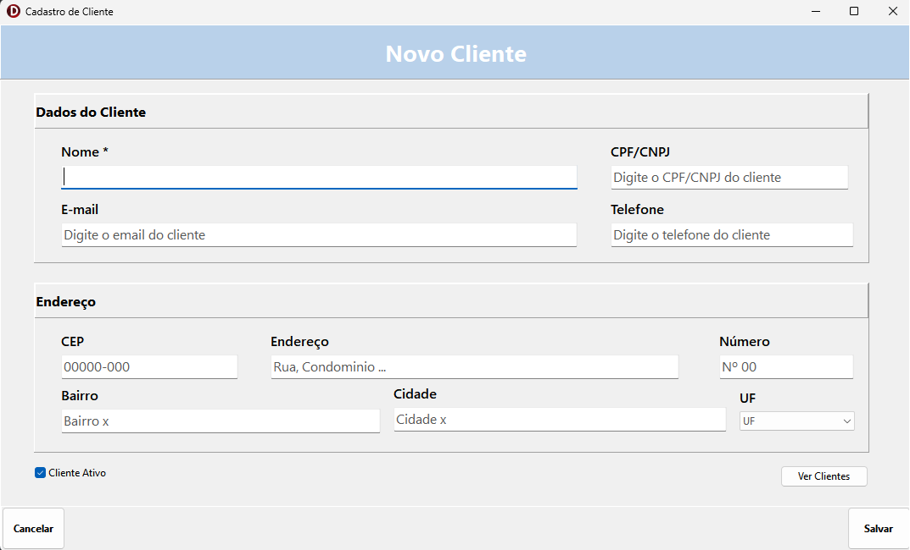

# 👥 CRUD de Clientes em Delphi + Firebird

Sistema desktop de cadastro de clientes desenvolvido em **Delphi (VCL)** com acesso a dados via **FireDAC** e banco **Firebird**: inclusão, listagem, alteração e exclusão.



## ✨ Funcionalidades

- **Cadastro** de clientes com dados pessoais e endereço
- **Listagem** de clientes em grid, ordenada por nome
- **Alteração**: o cliente escolhido na lista é carregado na tela de cadastro
- **Exclusão** com confirmação
- **Validação** de nome obrigatório e formato de e-mail
- Indicação de **cliente ativo/inativo**

## 🛠️ Tecnologias

- **Delphi** / Object Pascal
- **VCL** (Visual Component Library)
- **FireDAC** (TFDConnection, TFDQuery)
- **Firebird 5.0**
- **RAD Studio 13**

## 💡 Conceitos praticados

- **DataModule** centralizando a conexão e as queries, separado das telas
- **SQL com parâmetros** (`:NOME`, `:ID`...), protegendo contra SQL Injection
- **Chave primária automática** com `GENERATED BY DEFAULT AS IDENTITY`
- **Formulário modal** criado sob demanda (`Create` → `ShowModal` → `Free`)
- **Comunicação entre telas**: a lista devolve o ID escolhido para o cadastro
- Uma única tela para **incluir e alterar**, controlada pelo ID do cliente

## 🚀 Como executar

### 1. Firebird
Instale o [Firebird 5.0](https://firebirdsql.org/download) (Windows x64) e anote a senha do usuário `SYSDBA`.

### 2. Banco de dados
O banco de teste já está em `db/CLIENTES.FDB`. Se preferir criar um novo do zero, use o script `db/script.sql` pelo `isql`:

```sql
CREATE DATABASE 'localhost:C:\caminho\do\projeto\db\CLIENTES.FDB'
  DEFAULT CHARACTER SET UTF8;
INPUT 'C:\caminho\do\projeto\db\script.sql';
```

### 3. Projeto
1. Clone o repositório:
   ```bash
   git clone https://github.com/Luannax/CRUD-Clientes-Delphi-Firebird.git
   ```
2. Abra o `CRUD.dproj` no RAD Studio
3. No `uDM.pas`, ajuste a constante `CAMINHO_BANCO` e a senha do `SYSDBA`
4. Pressione **F9**

> ⚠️ **Atenção:** o projeto compila em **Windows 64-bit**, então o FireDAC usa a `fbclient.dll` de 64 bits, informada na propriedade `VendorLib` do `TFDPhysFBDriverLink`:
> `C:\Program Files\Firebird\Firebird_5_0\fbclient.dll`

## 📁 Estrutura

```
├── db/
│   ├── CLIENTES.FDB          # Banco de dados de teste
│   └── script.sql            # Criação da tabela CLIENTES
├── CRUD.dpr                  # Arquivo principal do projeto
├── CRUD.dproj                # Configurações do projeto
├── uDM.pas                   # Conexão e queries (DataModule)
├── tCRUD.pas                 # Tela de cadastro e alteração
└── uListaClientes.pas        # Tela de listagem e exclusão
```

## 🗺️ Próximos passos

- [ ] Pesquisa na lista por nome, CPF/CNPJ ou cidade
- [ ] Máscaras em CPF/CNPJ, telefone e CEP
- [ ] Validação de CPF/CNPJ
- [ ] Busca de endereço pelo CEP (API ViaCEP)
- [ ] Configuração do banco em arquivo `.ini`
- [ ] Relatório de clientes

## 👩‍💻 Autora

**Luanna Bahia**

[](https://www.linkedin.com/in/luannabahia)
[](https://github.com/Luannax)
